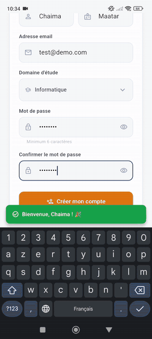
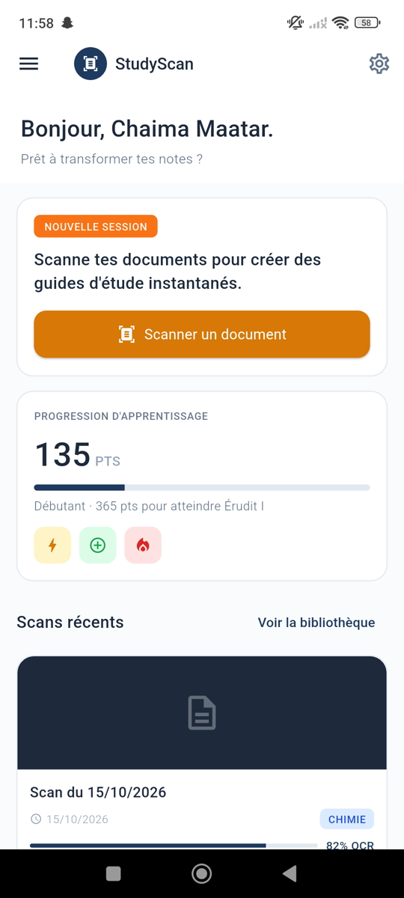
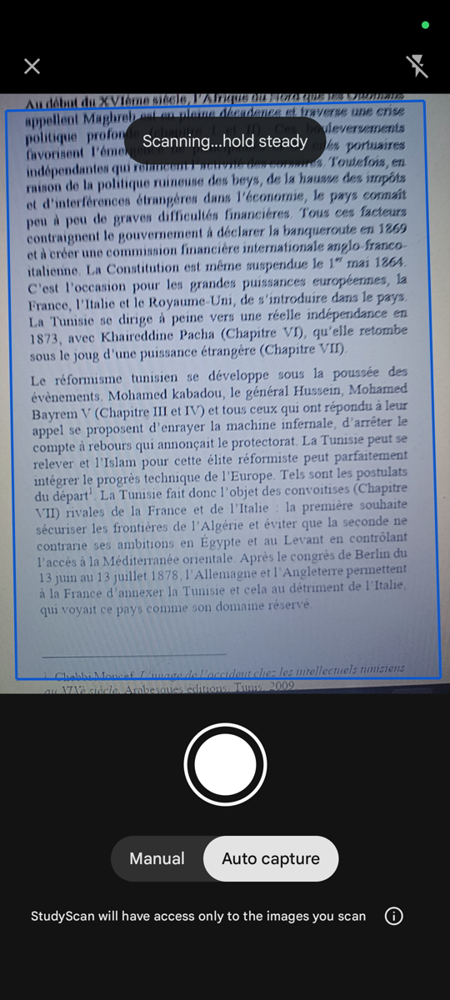
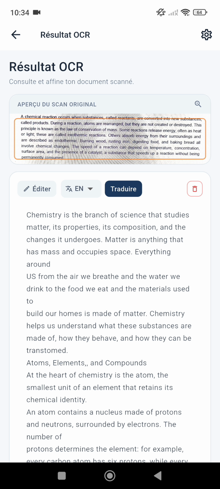
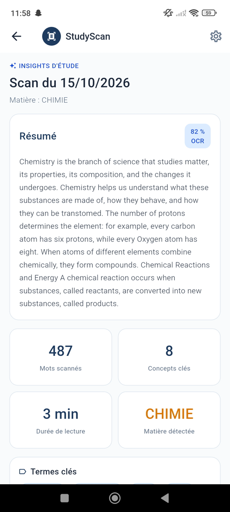
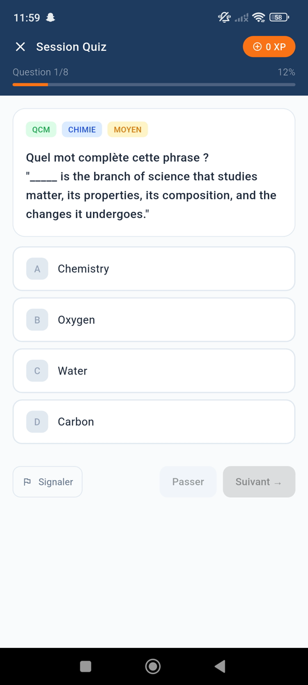
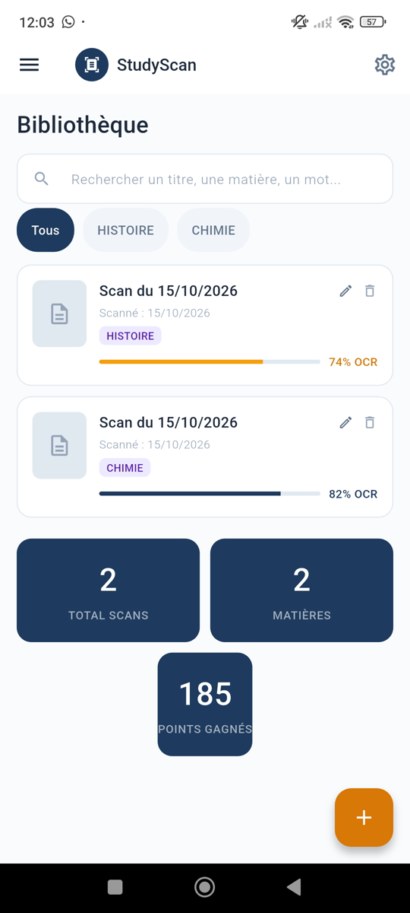
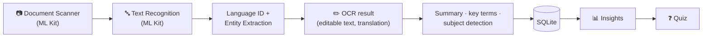

# 📚 StudyScan — Scan your course, get a summary and a quiz

Flutter mobile app for students: scan a course page with the camera, and StudyScan extracts the text, writes a **summary**,
picks the **key terms** and generates a **quiz** (multiple choice + true/false). Text recognition, language detection,
entity extraction and translation all run **on the device** with **Google ML Kit**.


<p align="center">
  
</p>

---

## ✨ Features

| | |
|---|---|
| 📷 **Document scanner** | ML Kit Document Scanner: automatic edge detection, crop and cleanup, 1 page or up to 5 pages per scan, or import from the gallery |
| 🔤 **OCR** | ML Kit Text Recognition, with the average **confidence** reported by ML Kit; the text can be corrected before saving |
| 📝 **Summary** | Extractive summary (SumBasic): keeps the most informative sentences, avoids repeating the same idea, about 30 % of the text |
| 🏷️ **Key terms & subject** | Most frequent meaningful words (French / English stop words removed, accents kept) and automatic subject detection |
| ❓ **Quiz** | Fill-in-the-blank multiple-choice questions and true/false statements (false ones are made by changing a date, a number or a key term) |
| 🌍 **Translation** | ML Kit language identification + on-device translation (French, English, Arabic) |
| 📅 **Entities** | Dates and addresses found in the text (ML Kit Entity Extraction) |
| 📚 **Library** | Saved scans (SQLite): search in titles, subjects and text, filter by subject, rename, delete |
| 🏆 **Gamification** | Points for each scan and correct answer, streak bonus, levels |
| 🔔 **Study reminders** | Weekly local notifications on the chosen days and time |
| 👤 **Account** | Firebase Authentication: sign up, log in, password reset by e-mail, change password and display name |

## 📸 Screenshots

| Home | Scanner | OCR result |
|---|---|---|
|  |  |  |

| Insights | Quiz | Library |
|---|---|---|
|  |  |  |

## 🏗️ How it works



The summary, key terms and quiz are generated with **simple text algorithms** (word frequencies, sentence selection),
not with a large language model: everything works offline once the ML Kit models are downloaded.

## 📁 Project structure

```
lib/
├── main.dart                     App entry point: Firebase, notifications, routes
├── pages/                        Login, register, home, scan, OCR result, insights, quiz, library, settings
├── services/
│   ├── scan.service.dart         ML Kit calls + summary, key terms and quiz generation
│   ├── auth.service.dart         Firebase Authentication
│   ├── notification.service.dart Weekly study reminders
│   └── prefs.service.dart        Points (shared_preferences)
├── models/                       Scan and quiz question models
├── utils/                        SQLite database, levels, validation, route observer
├── widgets/ · menu/              Scan card, navigation drawer
test/
└── scan_service_test.dart        Unit tests: summary, key terms, quiz
```

## 🚀 Getting started

**Requirements:** Flutter 3.38+ (Dart 3.10+), an Android device or emulator (Android 8.0+, API 26),
a [Firebase](https://console.firebase.google.com) project.

1. **Install the packages**
   ```bash
   flutter pub get
   ```
2. **Connect your Firebase project.** The Firebase configuration files are not committed: generate your own.
   In the Firebase console, create a project and enable **Authentication → Email/Password**. Then:
   ```bash
   npm install -g firebase-tools          # Firebase CLI
   firebase login
   dart pub global activate flutterfire_cli
   flutterfire configure                  # choose your project and the Android platform
   ```
   This creates `lib/firebase_options.dart` and `android/app/google-services.json`.
3. **Run the app** on a phone (USB debugging) or an emulator:
   ```bash
   flutter run
   ```
4. **Run the tests**
   ```bash
   flutter test
   ```

The first scan needs an internet connection: ML Kit downloads its language models (entity extraction, translation) once.

## ⚠️ Limitations

- Android only (the iOS project was not generated).
- OCR uses the Latin script model: Arabic text can be translated **to**, but not scanned.
- Scans and points are stored locally on the phone and are not separated per account.

## 👩‍💻 Authors

Academic project — Mobile Development course, IIT Sfax, 2025/2026.

- **Chaima Maatar** — [GitHub](https://github.com/MaatarChaima)
- **Salha Hentati**
